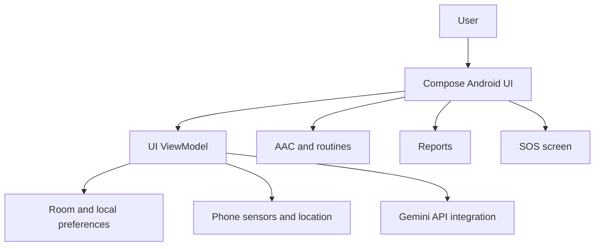

# CogniCare — Technical Design (source-code review)

## Scope
This document describes the Android project present in this repository, not a validated clinical or production system.

## Components
- **Android application:** Kotlin, Jetpack Compose, Android Gradle Plugin.
- **UI:** onboarding, AAC, monitoring, reports, SOS and supporting view-model classes in `app/src/main/java/com/example/ui/`.
- **Local data:** Room database, DAO and entity classes under `data/`.
- **Preferences:** `data/UserPreferences.kt`.
- **Environment sensing:** `data/SensorEnvironmentMonitor.kt`.
- **AI integration:** `network/GeminiApi.kt`, using Retrofit to call Google's Gemini API, with a demo fallback when a key is absent.
- **Android permissions:** internet, location, microphone, notifications and alarms are declared in `AndroidManifest.xml`.

## Conceptual flow

## Privacy and safety considerations
- Avoid committing real medical records, personal information, or API keys.
- Review Android runtime permissions and backup rules before real-world use.
- A mobile API key embedded in a shipped app may be extracted; use an authenticated backend for production.
- Sensor signals cannot diagnose distress or sensory overload.
- AI-generated medical summaries must be verified by qualified professionals.
- Emergency/SOS features must not be treated as a replacement for emergency services.

## Status
Source files and sample tests exist, but a successful Gradle build, end-to-end test, live API integration, and deployment have **not** been verified as part of this packaging exercise.
